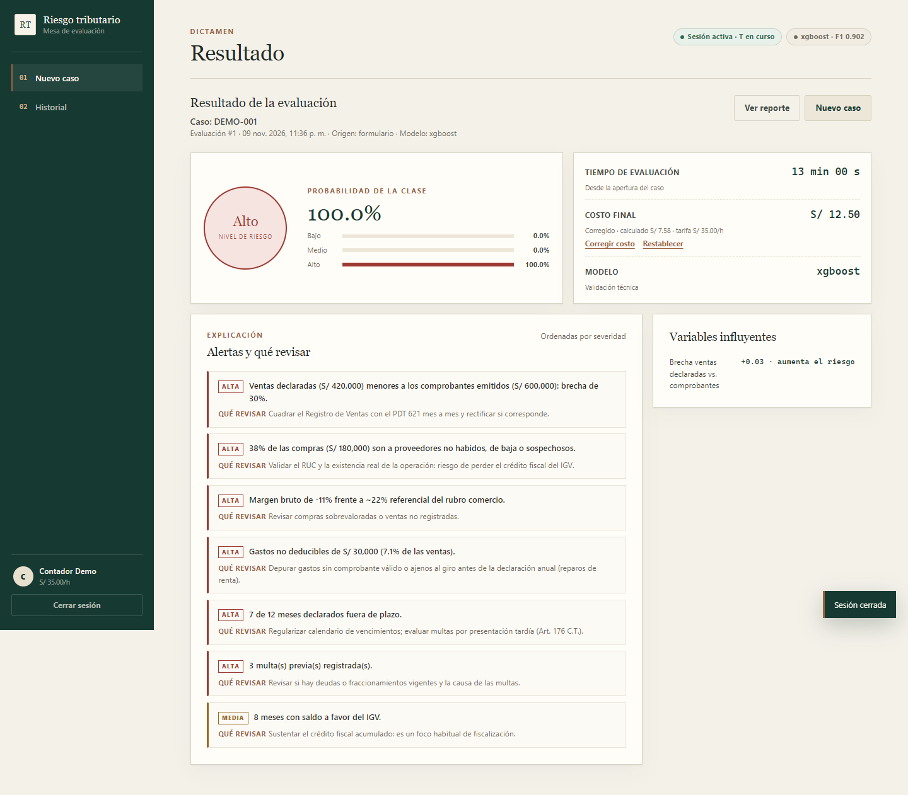

# Backend v2 — Asistente de riesgo tributario

Prototipo de tesis (UPAO): evalúa riesgo tributario de casos anonimizados, explica
alertas y registra el tiempo y el costo de cada evaluación.

- Backend Flask + SQLAlchemy + módulo ML.
- Interfaz web incluida en `/` (HTML/CSS/JS, sin build) para operar todo el flujo.
- Dataset sintético generado con reglas expertas ([docs/REGLAS_RIESGO.md](docs/REGLAS_RIESGO.md)).
- Reporte HTML, adjuntos CSV/Excel y exportación CSV de indicadores.



## Inicio rápido

Requiere Python 3.12+.

```bash
python -m venv .venv
# Windows
.venv\Scripts\activate
# Linux/macOS
source .venv/bin/activate

pip install -r requirements.txt
python -m ml.generar_dataset
python -m ml.train
python -m scripts.seed_demo      # usuarios y datos de demostración
python -m pytest -q
python run.py                    # http://127.0.0.1:5000/
```

Abre <http://127.0.0.1:5000/> y entra con:

| Email | Contraseña |
|---|---|
| `demo@example.test` | `Demo12345` |
| `prueba@example.test` | `Prueba12345` |

También puedes crear una cuenta desde la propia interfaz.

## Flujo de la interfaz

1. **Nuevo caso:** al abrirlo se llama `POST /api/evaluaciones/iniciar` y se guarda
   `sesion` para medir T.
2. **Subir archivos:** Registro de ventas, PDT 621 y Registro de compras opcional; hay
   plantillas descargables. Para pruebas, el botón **Cargar caso de ejemplo** inserta
   tres CSV de 12 meses y completa los datos del caso (temporal, fácil de retirar).
3. **Formulario guiado:** pasos Empresa → Ventas y compras → Cumplimiento.
4. **Resultado:** nivel, probabilidad por clase, alertas por severidad con “qué
   revisar”, variables influyentes, tiempo y costo corregible.
5. **Historial** y reporte HTML del caso.
6. **Errores 422** junto al campo correspondiente.

## API

Prefijo `/api`; autenticación `Authorization: Bearer <token>`. El contrato completo
está en [BACKEND.md](BACKEND.md). Endpoints principales:

```text
GET    /health, /opciones, /modelo
GET    /plantillas/{ventas|compras|pdt621}.csv
POST   /auth/registro, /auth/login
GET    /usuarios/yo          PATCH /usuarios/yo
POST   /evaluaciones/iniciar
POST   /evaluaciones          POST /evaluaciones/archivo
GET    /evaluaciones          GET /evaluaciones/<id>
GET    /evaluaciones/<id>/reporte
PATCH  /evaluaciones/<id>/costo
GET    /indicadores          GET /indicadores/exportar.csv   # solo análisis interno
```

## Estructura

```text
app/routes.py             endpoints
app/web.py                interfaz web
app/templates/            HTML
app/static/               CSS, JS, favicon
app/services/             auth, validación, archivos, alertas, predictor, reportes
ml/features.py            contrato de variables y variables derivadas
ml/generar_dataset.py     dataset sintético
ml/train.py               Random Forest / XGBoost / SVM
scripts/seed_demo.py      datos demo idempotentes
tests/                    suite pytest
docs/REGLAS_RIESGO.md     reglas que un contador debe validar
```

## Despliegue en Render

[](https://render.com/deploy?repo=https://github.com/CalluchiP/tesis-calluchi)

El repositorio incluye `render.yaml` (servicio web + PostgreSQL). En Render:

1. **New → Blueprint** y conectar `CalluchiP/tesis-calluchi`.
2. Render detecta `render.yaml`, crea la base de datos y genera `SECRET_KEY`.
3. El build instala dependencias, regenera el dataset y reentrena los modelos.
4. El arranque ejecuta `scripts.seed_demo` (idempotente) y levanta gunicorn.
5. Verificar `https://TU-SERVICIO.onrender.com/api/health`.

En el plan gratuito el servicio se suspende por inactividad y la base puede tener
límite de vigencia; para producción real se recomienda un plan pago y backups.

## Modelo y limitación

Se comparan tres modelos con validación cruzada de 5 pliegues y se guarda el de mayor
F1 macro (`models/modelo_riesgo.joblib`). Las métricas actuales (F1 ≈ 0.90) miden qué
tan bien el modelo aprende las reglas sintéticas; **no** son desempeño real en Trujillo.
La validez del enfoque depende de que un contador revise y valide las reglas.

Nunca uses RUC, DNI ni razón social real: `referencia` es un alias anonimizado.
